# 🤖 Autonomous Racer Robot (Fork Robot — 4WD Edition) — Guidance & Documentation

[](https://www.arduino.cc/)
[](https://isocpp.org/)
[](https://creativekhan123.github.io/Racerbot-Guidance/)
[](./Autonomous_Racer_Robot.html)
[]()
[]()
[]()
[]()
[]()

> **Teacher-friendly assembly, wiring, logic, and code guidance for building a 4WD autonomous obstacle-avoiding racer robot.**

---

## 📸 Project Showcase

<div align="center">
  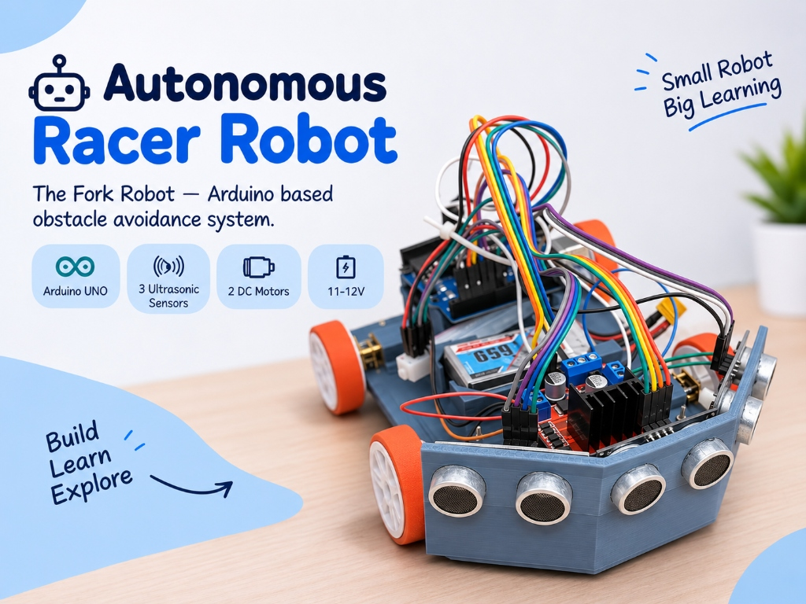
  <p><em>The assembled 4WD Autonomous Racer Robot ("Fork Robot") equipped with 3 forward-facing ultrasonic sensors in an angled bumper, L298N dual H-bridge motor driver, and 4 high-traction orange treaded wheels driven by M20 micro gear motors.</em></p>
</div>

---

## 📑 Table of Contents

- [Project Overview](#-project-overview)
- [Interactive Documentation Webpage](#-interactive-documentation-webpage)
- [Hardware Components](#-hardware-components)
- [Component Gallery](#-component-gallery)
- [Circuit & Wiring Guide](#-circuit--wiring-guide)
  - [Ultrasonic Sensors](#1-ultrasonic-sensor-connections)
  - [Motor Driver & Motors](#2-l298n-motor-driver-connections)
  - [Power Supply](#3-power-supply-connections)
- [How It Works (Autonomous Logic)](#-how-it-works-autonomous-logic)
- [Arduino Source Code](#-arduino-source-code)
- [Assembly & Setup (9 Steps)](#-assembly--setup-steps)
- [Pre-Flight Testing Checklist](#-pre-flight-testing-checklist)
- [Safety & Battery Guidelines](#-safety--battery-guidelines)
- [Author & License](#-author--license)

---

## 🎯 Project Overview

The **Autonomous Racer Robot** (nicknamed **"Fork Robot"** due to its three forward-pointing sensor prongs) is an intelligent, self-navigating 4WD mobile robot built using an **Arduino UNO** microcontroller board.

### Key Capabilities:
- **3-Way Real-Time Radar Perception**: Continuously scans distance on the **Left**, **Center**, and **Right** using three HC-SR04 ultrasonic sensors mounted at optimal forward detection angles.
- **Dynamic 4WD Obstacle Avoidance**: Automatically steers away from walls, obstacles, and dead ends without human intervention using high-traction 4-wheel differential steering.
- **4× M20 300 RPM Micro Gear Motors**: Heavy-duty metal reduction gearboxes provide all-wheel drive pulling power, stable low-noise running, and responsive cornering.
- **L298N Dual H-Bridge Motor Driver**: Proven high-current dual motor driver switching 7.4V LiPo battery power smoothly across the left and right motor pairs.
- **Beginner & Classroom Friendly**: Uses standard Arduino built-in functions with zero external dependencies, making it an ideal STEM robotics curriculum project.

---

## 🌐 Interactive Documentation Webpage

This repository includes a **complete, standalone interactive documentation webpage**:

📄 **[`Autonomous_Racer_Robot.html`](./Autonomous_Racer_Robot.html)**

### Webpage Highlights:
- **100% Self-Contained**: Works offline by double-clicking the file in any browser (Chrome, Edge, Safari, Firefox).
- **Dark Mode & Light Mode**: Built-in toggle button in the navbar and a floating action button (FAB).
- **Mobile & Android Responsive**: Specially optimized layout that renders cleanly on smartphones and tablets.
- **Interactive Component Gallery Grid**: Click any component card to reveal detailed specifications and teacher notes.
- **One-Click Code Copy & Download**: Download `Autonomous_Racer_Robot.ino` with a single click or copy directly into the Arduino IDE.
- **Interactive Testing Checklist**: Check off testing steps before deployment with automatic state persistence.
- **Print Friendly**: Specially formatted CSS for printing physical classroom handouts.

---

## 🛠 Hardware Components

| Component | Specification | Qty | Function in Robot | Purchase / Source Link |
| :--- | :--- | :---: | :--- | :--- |
| **Arduino UNO** | ATmega328P, 5V, 16 MHz | 1 | Central controller executing sensor logic and motor commands | [Amazon India](https://www.amazon.in/Arduino-Uno-Rev3-SMD-A000073/dp/B00CL79U6S) |
| **L298N Motor Driver Module** | Dual H-Bridge driver board (2A/ch) | 1 | High-current driver switching power to 4 DC motors | [Robu.in](https://robu.in/product/l298n-2a-based-motor-driver-module-good-quality/?gad_source=1&gad_campaignid=20387462343&gbraid=0AAAAADvLFWdPHBJ4WOo7tem7nL7nw4T4g&gclid=CjwKCAiAhqHXBhAXEiwATbksU4IZXTA4FEj_z3hYBTVaAXA_3XAA7-emdi2HB8lAHeeJk7ujOfHiMhoCWfEQAvD_BwE) |
| **M20 / N20 DC Gear Motors** | Micro metal gearbox, 300 RPM | 4 | All-metal geared motors providing 4WD drive torque | [Robu.in](https://robu.in/product/n20-6v-300-rpm-micro-metal-gear-motor/) |
| **Wheel 3D model &times;4** | Custom 3D-printed drive wheels with M20/N20 D-shaft hub (`Original Robojunkies.step`) | 4 | 3D-printed drive wheels fitted with octopus bat grip tire sleeves | [Download STEP](./Original%20Robojunkies.step) &bull; [Download STL](./Original_Robojunkies_wheel.stl) |
| **Ultrasonic Sensors** | HC-SR04 (40 kHz sound) | 3 | 3-way distance measurement (Left, Center, Right) | [Amazon India](https://www.amazon.in/REES52-Ultrasonic-Distance-Sensor-Arduino/dp/B01FDI6AHS) |
| **Robot Chassis** | 4WD platform with angled bumper | 1 | Structural skeleton holding all 4 motors, driver, and sensors | [Download AutonomousRacerBot.stl](./AutonomousRacerBot.stl) |
| **Battery Pack** | Orange 7.4V 850mAh 2S LiPo Battery | 1 | High-discharge power source for motors and Arduino | [Robu.in](https://robu.in/product/orange-850mah-2s-30c-60c-lithium-polymer-battery-pack-lipo/) |
| **Jumper Wires** | DuPont Male-to-Female & M-M | ~20 | Signal and power interconnects between boards and sensors | [Amazon India](https://www.amazon.in/Fly-Robo-Breadboard-Wires-10cm-Male-Female-Female-Female/dp/B0CYLN6Z17) |
| **Cricket Bat Grip** | Octopus textured rubber sleeve for wheels | 1 | High-traction tire sleeves cut & stretched over 4 wheels | [Amazon India](https://www.amazon.in/DSC-Octopus-Cricket-Grip-Color/dp/B0BG8SYZB7) |
| **3D-Printed Motor Clamps** | Custom brackets for N20/M20 motors (`motor clamp.stl`) | 4 | Clamp 4&times; micro gear motors firmly onto chassis | [Download STL](./motor%20clamp.stl) &bull; [3D Bundle](./3D_Models/3D_Models.zip) |
| **M2 &times; 10mm Socket Head Cap Bolts** | Stainless steel 304 Allen cap bolts | 8–12 | Secure 3D-printed motor clamps (`motor clamp.stl`) to chassis | [Robokits](https://robokits.co.in/robot-parts/nut-bolts-standoffs/allen-cap-socket-head-bolts/m2-x-10mm-socket-head-cap-stainless-steel-304-bolt-moq-12-pcs?srsltid=AYCX9vIl3XfMImSpwQeJgNYU7eYxyWvO1huRkra0ZrYR0H0_df9LIzPK) |
| **Stainless steel hex nuts &times;3** | EasyMech M2 stainless steel hex nuts | As req. | Fasten & lock M2 bolts underneath the chassis | [Robu.in](https://robu.in/product/easymech-m2-ss-hex-nut-50-pcs/) |
| **M3 &times; 10mm Hex CSK Screws &times;3** | Grade 10.9 High Tensile Black Oxide (Dia 3mm, Length 10mm) | 3 | Flush-head structural chassis & board mounting | [OnlyScrews.in](https://onlyscrews.in/products/m3-x-10mm-hex-allen-csk-high-tensile10-9-black-oxide-screw-dia-3mm-length-10mm?currency=INR&country=IN&variant=51455871484217&stkn=6e84ebfba1b8&utm_source=google&utm_medium=cpc&utm_campaign=Inderans_Campaign&utm_content=Other_than_fasteners_wala_copy&gad_source=1&gad_campaignid=22229905346&gclid=EAIaIQobChMIh7HMhZfrlwMVhYhmAh0E0QY9EAQYBSABEgKS3_D_BwE) |

---

## 🖼 Component Gallery

<table align="center">
  <tr>
    <td align="center" width="50%">
      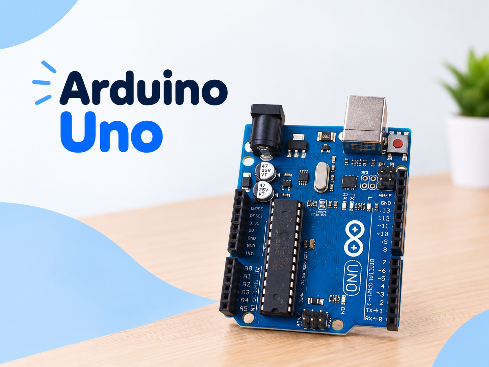<br/>
      <strong>Arduino UNO</strong><br/>
      <em>Main Microcontroller &middot; Brain</em>
    </td>
    <td align="center" width="50%">
      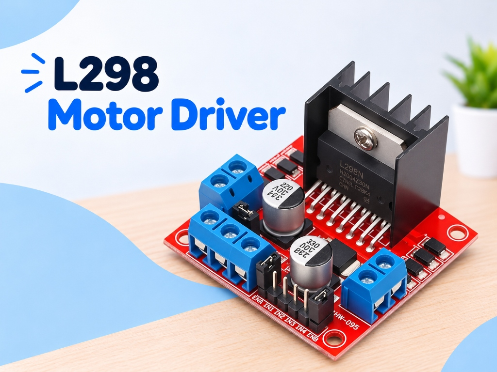<br/>
      <strong>L298N Motor Driver Module</strong><br/>
      <em>Dual H-Bridge High-Power Driver</em>
    </td>
  </tr>
  <tr>
    <td align="center" width="50%">
      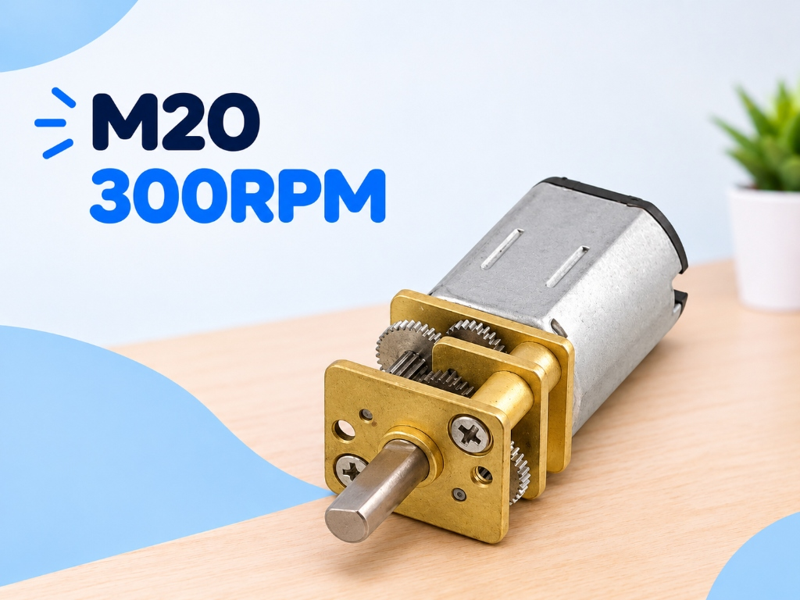<br/>
      <strong>M20 DC Gear Motors &times;4</strong><br/>
      <em>300 RPM Micro Metal Gear Motors (4WD)</em>
    </td>
    <td align="center" width="50%">
      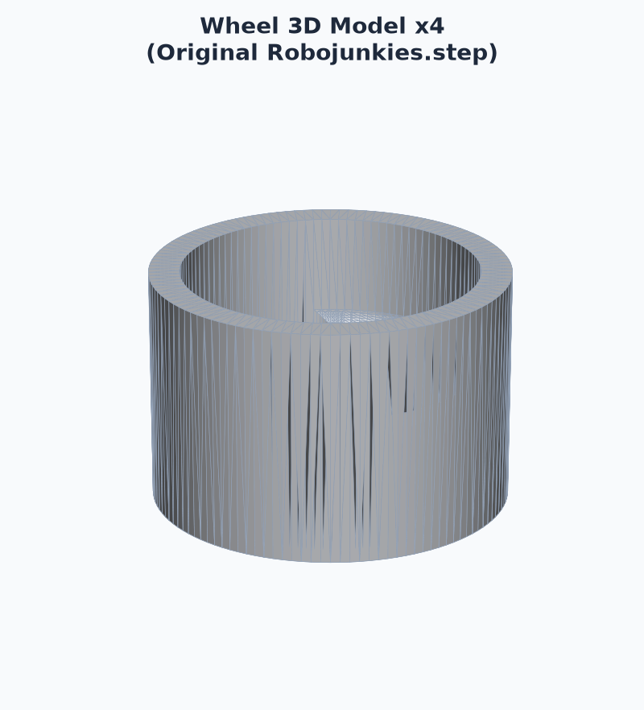<br/>
      <strong>Wheel 3D model &times;4</strong><br/>
      <em>Custom 3D-Printed Drive Wheels (Original Robojunkies.step)</em>
    </td>
  </tr>
  <tr>
    <td align="center" width="50%">
      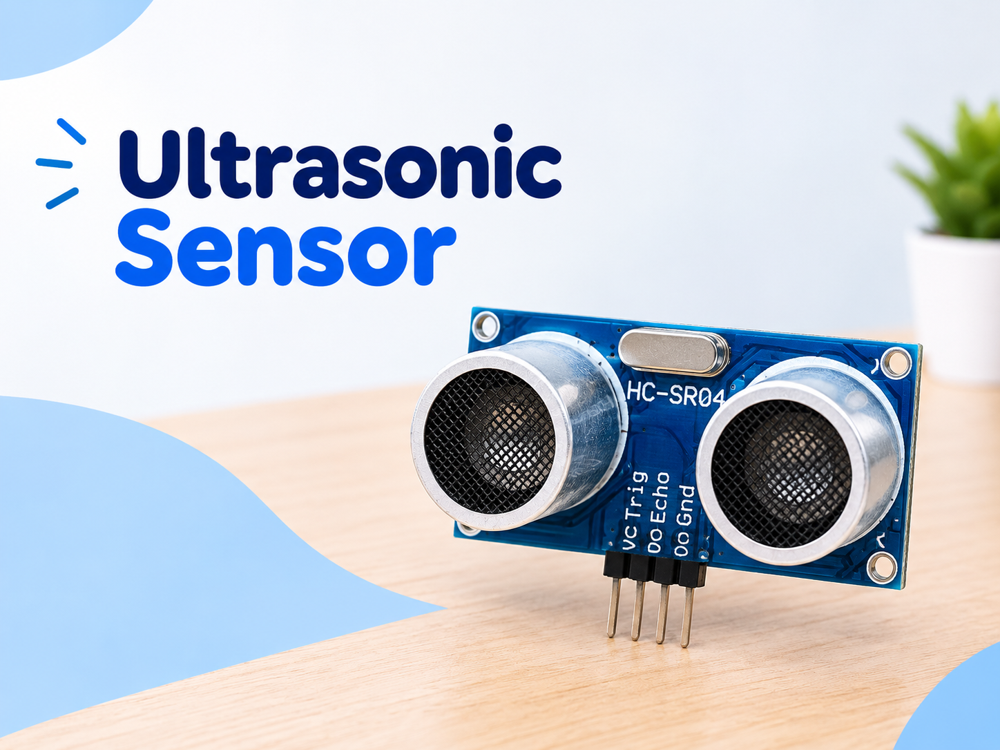<br/>
      <strong>HC-SR04 Ultrasonic Sensors &times;3</strong><br/>
      <em>Acoustic 3-Way Distance Sensors</em>
    </td>
    <td align="center" width="50%">
      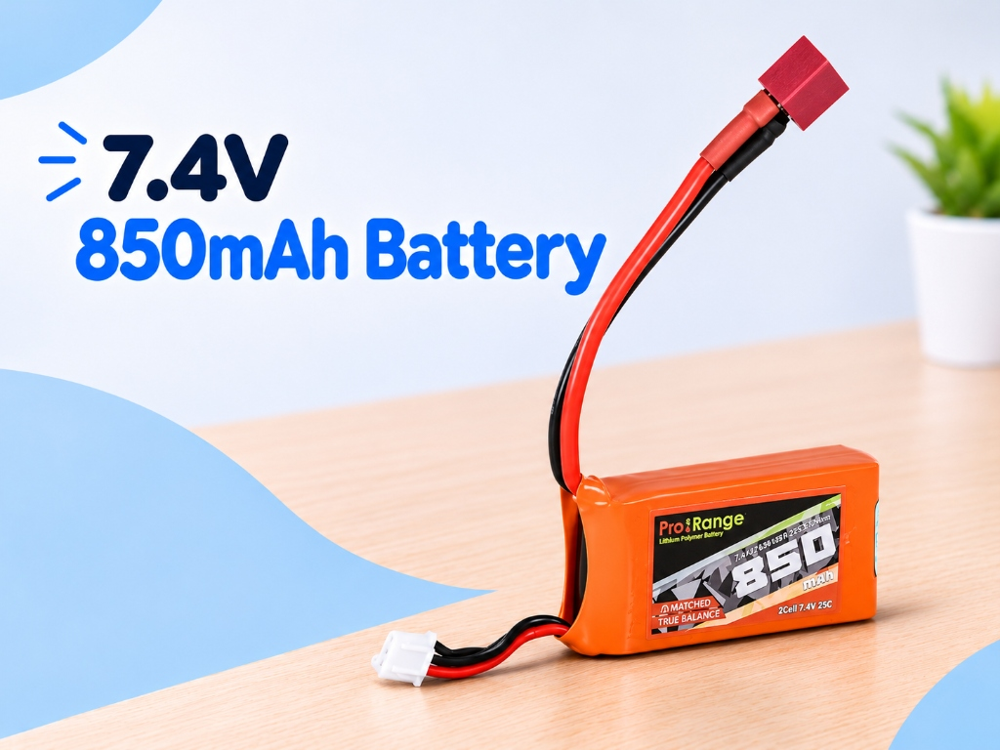<br/>
      <strong>Orange 7.4V 850mAh 2S LiPo Battery</strong><br/>
      <em>High-Discharge 2S Lithium Polymer Battery Pack</em>
    </td>
  </tr>
  <tr>
    <td align="center" width="50%">
      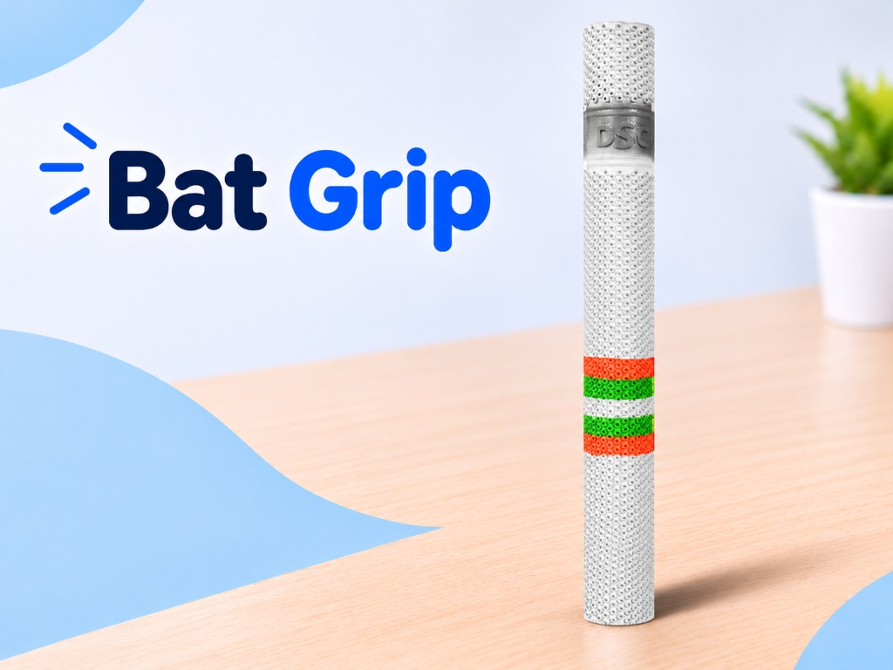<br/>
      <strong>Cricket Bat Grip</strong><br/>
      <em>Octopus Textured Wheel Tire Sleeves</em>
    </td>
    <td align="center" width="50%">
      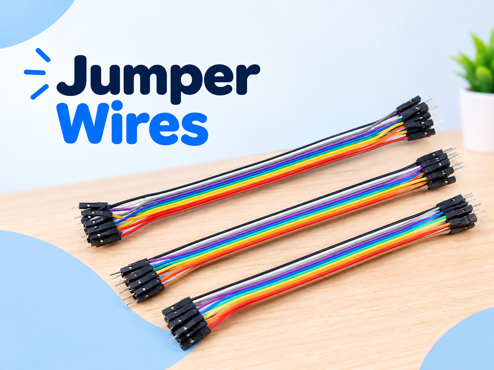<br/>
      <strong>Multi-Color Jumper Wires</strong><br/>
      <em>DuPont Signal & Power Interconnects</em>
    </td>
  </tr>
  <tr>
    <td align="center" width="50%">
      <br/>
      <strong>4WD Robot Chassis Platform</strong><br/>
      <em>3D-Printed Baseplate (AutonomousRacerBot.stl)</em>
    </td>
    <td align="center" width="50%">
      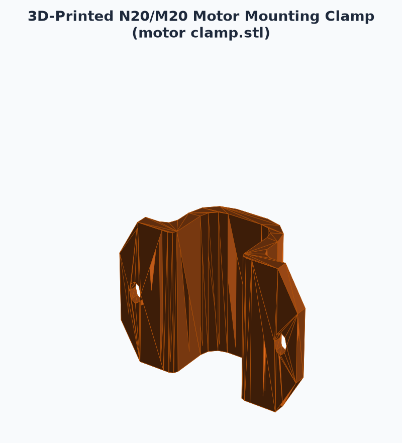<br/>
      <strong>3D-Printed Motor Mounting Clamps &times;4</strong><br/>
      <em>Chassis Motor Brackets (motor clamp.stl)</em>
    </td>
  </tr>
  <tr>
    <td align="center" width="50%">
      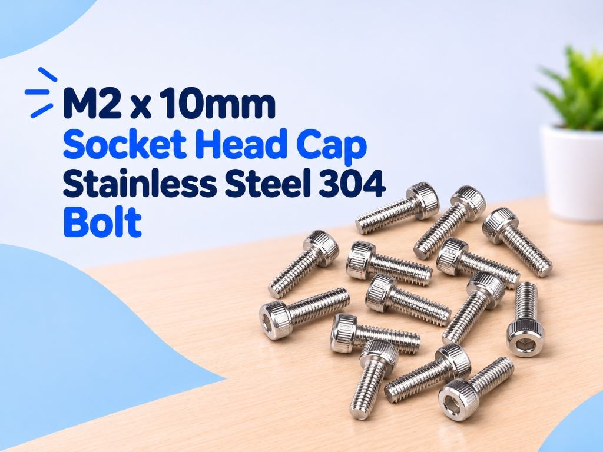<br/>
      <strong>M2 &times; 10mm Socket Head Cap Bolts</strong><br/>
      <em>Stainless Steel 304 Motor Clamp Fasteners</em>
    </td>
    <td align="center" width="50%">
      <br/>
      <strong>Stainless steel hex nuts &times;3</strong><br/>
      <em>EasyMech M2 Stainless Steel Hex Nuts</em>
    </td>
  </tr>
  <tr>
    <td align="center" width="50%">
      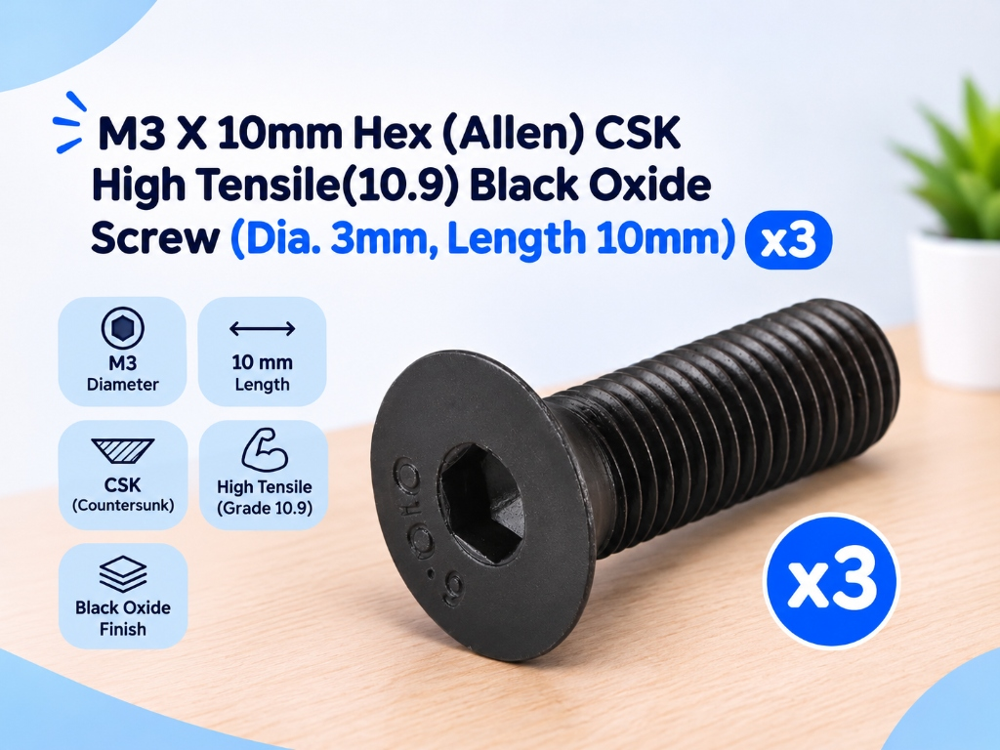<br/>
      <strong>M3 &times; 10mm Hex CSK Screws &times;3</strong><br/>
      <em>Grade 10.9 High Tensile Black Oxide Screws</em>
    </td>
    <td align="center" width="50%">
      <a href="Autonomous_Racer_Robot.html#components">
        <br/>
        <strong>Full Robot Assembly &amp; Documentation</strong><br/>
        <em>Interactive Webpage &amp; 3D Model Viewers</em>
      </a>
    </td>
  </tr>
</table>

---

## 🔌 Circuit & Wiring Guide

<div align="center">
  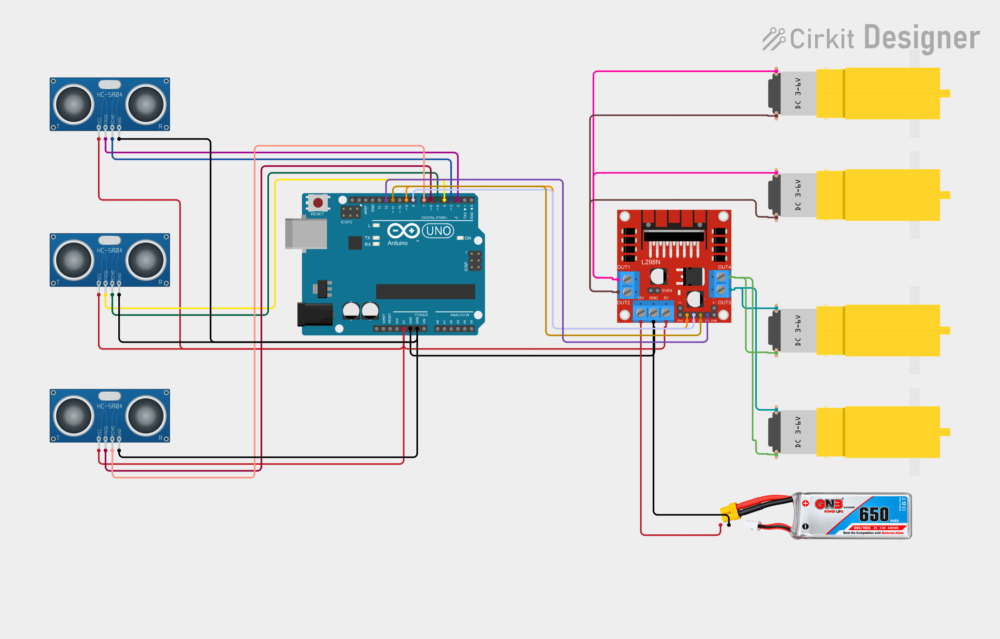
  <p><em>Full 4WD Circuit Diagram — Arduino UNO, L298N Dual H-Bridge Motor Driver, 3× HC-SR04 Ultrasonic Sensors, 4× M20 Motors, and 7.4V LiPo Battery.</em></p>
</div>

---

### 1. Ultrasonic Sensor Connections

All three HC-SR04 sensors share standard `5V` and `GND` power rails from the Arduino. Signal pins connect directly to digital I/O pins D2 through D7:

| Sensor Position | Sensor Pin | Arduino Pin | Pin Function |
| :--- | :--- | :--- | :--- |
| **Left Sensor** | `VCC` | `5V` | 5V Power |
| **Left Sensor** | `GND` | `GND` | Ground |
| **Left Sensor** | `TRIG` | `D2` | Trigger output pulse |
| **Left Sensor** | `ECHO` | `D3` | Echo input signal |
| **Center Sensor** | `VCC` | `5V` | 5V Power |
| **Center Sensor** | `GND` | `GND` | Ground |
| **Center Sensor** | `TRIG` | `D4` | Trigger output pulse |
| **Center Sensor** | `ECHO` | `D5` | Echo input signal |
| **Right Sensor** | `VCC` | `5V` | 5V Power |
| **Right Sensor** | `GND` | `GND` | Ground |
| **Right Sensor** | `TRIG` | `D6` | Trigger output pulse |
| **Right Sensor** | `ECHO` | `D7` | Echo input signal |

---

### 2. L298N Motor Driver Connections

The L298N driver receives logic signals from the Arduino and powers the 4 M20 motors (two left motors in parallel, two right motors in parallel):

| L298N Pin / Terminal | Connected To | Arduino Pin | Description |
| :--- | :--- | :--- | :--- |
| **IN1** | Left Motors PWM Speed | `D9` | Speed PWM signal for left motor pair |
| **IN2** | Left Motors Direction | `D8` | Direction control for left motor pair |
| **IN3** | Right Motors PWM Speed | `D11` | Speed PWM signal for right motor pair |
| **IN4** | Right Motors Direction | `D12` | Direction control for right motor pair |
| **ENA & ENB** | 5V Jumper Caps | Fitted | Keep jumpers fitted to enable both channels |
| **OUT1 & OUT2** | Left M20 Motors (&times;2) | Motor Terminals | 2 Left motors connected in parallel |
| **OUT3 & OUT4** | Right M20 Motors (&times;2) | Motor Terminals | 2 Right motors connected in parallel |

---

### 3. Power Supply Connections

| Terminal | Power Wire | Voltage | Notes |
| :--- | :--- | :--- | :--- |
| **L298N 12V / VMS (+)** | 7.4V Battery Red Wire (+) | `+7.4V` | Powers the 4 M20 motors. **Verify polarity!** |
| **L298N GND (-)** | 7.4V Battery Black Wire (-) | `0V (GND)` | Ground reference from battery |
| **L298N GND (-)** | Arduino GND Pin | `GND` | **Crucial!** Common ground reference |
| **L298N 5V Out** | Arduino 5V / VIN Pin | `5V` | Optional regulated 5V to power Arduino |

> ⚠️ **IMPORTANT POWER SAFETY**:
> - Always verify battery polarity (`+` to `+`, `-` to `-`). Reversing polarity can permanently damage the L298N driver and Arduino.
> - Never connect the 7.4V LiPo battery directly to Arduino 5V or I/O pins.
> - Always connect L298N GND and Arduino GND together to establish a shared ground reference.

---

## 🧠 How It Works (Autonomous Logic)

The robot operates using a continuous sense-think-act control loop:

```
[Start Loop]
     │
     ▼
[Read 3 Ultrasonic Sensors] (Left, Center, Right in cm)
     │
     ├───────────────────────────────────────────────────────┐
     │                                                       │
     ▼                                                       ▼
[Center < 15 cm?]                                      [Center Clear (>= 15 cm)]
     │ YES                                                   │
     ▼                                                       ├─ Left < 12 cm?  ──► Turn RIGHT (+200, -200)
[Reverse & Turn]                                             ├─ Right < 12 cm? ──► Turn LEFT  (-200, +200)
(Back up 220ms, then pivot left 220ms)                       └─ Both Clear?    ──► Cruise FORWARD (130, 130)
```

### Decision Matrix:

| Sensor Condition | Distance Thresholds | Robot Action | Left Motors | Right Motors |
| :--- | :--- | :--- | :---: | :---: |
| **Path Ahead Clear** | Center &ge; 15cm, Left & Right &ge; 12cm | Cruise forward smoothly | `FORWARD (PWM 130)` | `FORWARD (PWM 130)` |
| **Obstacle on Left** | Left &lt; 12cm, Right &ge; 12cm | Steer right in place | `FORWARD (PWM 200)` | `REVERSE (PWM 200)` |
| **Obstacle on Right** | Right &lt; 12cm, Left &ge; 12cm | Steer left in place | `REVERSE (PWM 200)` | `FORWARD (PWM 200)` |
| **Front Obstacle / Corner** | Center &lt; 15cm | 1. Reverse 220ms<br/>2. Pivot Left 220ms | 1. `REVERSE (-200)`<br/>2. `REVERSE (-200)` | 1. `REVERSE (-200)`<br/>2. `FORWARD (+200)` |

---

## 💻 Arduino Source Code

The full, tested Arduino sketch is located at:

📁 **[`arduino_code/arduino_code.ino`](./arduino_code/arduino_code.ino)** (also available as **[`autoracerl298n.ino`](./autoracerl298n.ino)**)

```cpp
// Motor Driver Pins (PWM pins on Uno: 3,5,6,9,10,11)
const int IN1 = 9;   // Left motor speed
const int IN2 = 8;   // Left motor direction
const int IN3 = 11;  // Right motor speed
const int IN4 = 12;  // Right motor direction (D12)

// Ultrasonic Sensor Pins
const int trig1 = 2;  const int echo1 = 3;   // Left sensor
const int trig2 = 4;  const int echo2 = 5;   // Center sensor
const int trig3 = 6;  const int echo3 = 7;   // Right sensor


const float MAX_SENSOR_DISTANCE       = 200.0;  // cm
const float FRONT_OBSTACLE_THRESHOLD  = 15.0;   // cm - center sensor triggers backup + turn
const float SIDE_OBSTACLE_THRESHOLD   = 12.0;   // cm - left/right sensors trigger turn
const unsigned long SENSOR_INTERVAL   = 50;     // ms between sensor reads
const unsigned long BACKUP_DURATION   = 220;    // ms to reverse when front obstacle detected

unsigned long lastSensorReadTime = 0;

// ==========================================
// MOTOR CONTROL
// ==========================================

void motor1(int speed) {       //Left Motor speed
  if (speed > 0) {
    digitalWrite(IN1, LOW);
    analogWrite(IN2, speed);       // Forward
  } else if (speed < 0) {
    digitalWrite(IN1, HIGH);
    analogWrite(IN2, speed);      // Backward 
  } else {
    digitalWrite(IN1, HIGH);
    analogWrite(IN2, HIGH);           // Stop
  }
}

void motor2(int speed) {      //Right Motor speed 
  if (speed > 0) {
    digitalWrite(IN3, LOW);
    analogWrite(IN4, speed);       // Forward
  } else if (speed < 0) {
    digitalWrite(IN3, HIGH);
    analogWrite(IN4, speed);      // Backward (negate to get positive PWM value)
  } else {
    digitalWrite(IN3, HIGH);
    analogWrite(IN4, HIGH);           // Stop
  }
}

void motorControl(int leftSpeed, int rightSpeed) {
  motor1(leftSpeed);
  motor2(rightSpeed);
}


void setup() {
  Serial.begin(9600);

  // Ultrasonic pins
  pinMode(trig1, OUTPUT); pinMode(echo1, INPUT);
  pinMode(trig2, OUTPUT); pinMode(echo2, INPUT);
  pinMode(trig3, OUTPUT); pinMode(echo3, INPUT);

  // Motor pins
  pinMode(IN1, OUTPUT); pinMode(IN2, OUTPUT);
  pinMode(IN3, OUTPUT); pinMode(IN4, OUTPUT);

  motorControl(0, 0); // Start stopped
  Serial.println("Robot Ready!");
}


void loop() {
  unsigned long currentMillis = millis();


  if (currentMillis - lastSensorReadTime >= SENSOR_INTERVAL) {
    lastSensorReadTime = currentMillis;

    float leftDist   = getDistance(trig1, echo1);
    float centerDist = getDistance(trig2, echo2);
    float rightDist  = getDistance(trig3, echo3);

    Serial.print(leftDist);
    Serial.print("       ");
    Serial.print(centerDist);
    Serial.print("       ");
    Serial.println(rightDist);


    if (centerDist < FRONT_OBSTACLE_THRESHOLD) {
      // Back up briefly, then turn left for the same duration
      motorControl(-200, -200);
      delay(BACKUP_DURATION);
      motorControl(-200, 200);  // Turn Left in place
      delay(BACKUP_DURATION);
    }
    else if (leftDist < SIDE_OBSTACLE_THRESHOLD) {
      motorControl(200, -200);  // Turn Right in place
    }
    else if (rightDist < SIDE_OBSTACLE_THRESHOLD) {
      motorControl(-200, 200);  // Turn Left in place
    }
    else {
      motorControl(130, 130);   // Go Forward
    }
  }
}

float getDistance(int trigPin, int echoPin) {
  digitalWrite(trigPin, LOW);
  delayMicroseconds(2);
  digitalWrite(trigPin, HIGH);
  delayMicroseconds(10);
  digitalWrite(trigPin, LOW);
                                                                                                                                                                         
  long timeout = (MAX_SENSOR_DISTANCE * 2.0 / 0.0343) + 3000;
  long duration = pulseIn(echoPin, HIGH, timeout);

  if (duration == 0) return MAX_SENSOR_DISTANCE;

  float distance = duration * 0.0343 / 2.0;

  if (distance > MAX_SENSOR_DISTANCE) return MAX_SENSOR_DISTANCE;
  if (distance < 0) return 0.0;

  return distance;

}
```

---

## 🔨 Assembly & Setup Steps

1. **Prepare 4WD Chassis**: Unpack the 4WD chassis base and identify mounting slots for the four M20 motors, L298N driver, Arduino, battery, and 3-sensor bumper.
2. **Mount 4x M20 Motors & Wheels (with 3D Clamps & Bat Grip)**: Secure the four 300 RPM M20 micro gear motors into side mounting brackets (2 left, 2 right) using the 3D-printed motor clamps (`motor clamp.stl`) tightened with M2x10mm socket head cap bolts and locked with M2 stainless steel hex nuts. Cut four rings from the rubber cricket bat grip and stretch them securely over the four 3D-printed wheels (Original Robojunkies.step) for enhanced octopus-pattern traction, then press each wheel firmly onto the motor output shaft.
3. **Mount Arduino & L298N Module**: Fasten the Arduino UNO and the L298N motor driver module onto the chassis using the three M3&times;10mm countersunk hex screws (`m3_csk_screws.jpg`) and standoffs, ensuring flush seating with the chassis base.
4. **Mount 3 Ultrasonic Sensors**: Insert the three HC-SR04 sensors into the angled front bumper housing facing Left, Center, and Right.
5. **Connect Sensor Wiring**: Connect VCC&rarr;5V, GND&rarr;GND, Left TRIG/ECHO&rarr;D2/D3, Center TRIG/ECHO&rarr;D4/D5, and Right TRIG/ECHO&rarr;D6/D7.
6. **Connect Motor Terminals**: Wire the two left M20 motors in parallel to OUT1 & OUT2, and the two right M20 motors in parallel to OUT3 & OUT4. Connect IN1&rarr;D9, IN2&rarr;D8, IN3&rarr;D11, IN4&rarr;D12.
7. **Connect 7.4V Power Supply**: Connect the 7.4V LiPo battery (+) to the L298N 12V terminal, battery (-) to GND, and link L298N GND to Arduino GND (common ground). **Check polarity!**
8. **Upload Arduino Program**: Connect Arduino to computer via USB, open `autoracerl298n.ino` in Arduino IDE, select **Arduino UNO**, and click **Upload**.
9. **Field Test**: Place the 4WD robot on a clear floor, power on the 7.4V LiPo battery, and watch it cruise and steer smoothly around obstacles!

---

## ✅ Pre-Flight Testing Checklist

- [ ] Arduino UNO powers on (green LED lit)
- [ ] L298N motor driver power LED lit steadily
- [ ] Common ground connected between L298N GND and Arduino GND
- [ ] 7.4V LiPo Battery polarity verified (`+` Red, `-` Black)
- [ ] Both left M20 motors rotate forward when commanded
- [ ] Both right M20 motors rotate forward when commanded
- [ ] All 4 M20 gear motors securely fastened to chassis with 3D-printed clamps (`motor clamp.stl`)
- [ ] All M2x10mm socket head cap bolts and stainless steel hex nuts tightened securely
- [ ] All M3x10mm CSK countersunk hex screws seated flush and tightened securely
- [ ] All 4 small wheels fitted with rubber bat grip tire sleeves, spinning freely without chassis contact
- [ ] Left ultrasonic sensor displays accurate distance on Serial Monitor (D2/D3)
- [ ] Center ultrasonic sensor displays accurate distance on Serial Monitor (D4/D5)
- [ ] Right ultrasonic sensor displays accurate distance on Serial Monitor (D6/D7)
- [ ] Robot cruises forward smoothly (PWM 130) when path is clear
- [ ] Robot turns right in place when obstacle placed &lt; 12 cm near left sensor
- [ ] Robot turns left in place when obstacle placed &lt; 12 cm near right sensor
- [ ] Robot reverses (220 ms) and pivots when obstacle &lt; 15 cm directly in front

---

## ⚠️ Safety & Battery Guidelines

- **Polarity Warning**: Never reverse battery polarity. Reversing `+` and `-` will burn the L298N driver IC immediately.
- **Common Ground Requirement**: Always ensure L298N GND and Arduino GND are connected together so logic signals have a reference point.
- **Voltage Separation**: Never feed 7.4V directly into Arduino 5V or I/O pins (pins operate at 5V logic only).
- **Mechanical Safety**: Keep fingers, hair, and loose wires away from the 4 spinning wheels and motor gears while powered.
- **Safe Testing Area**: Test the robot on an open, flat floor away from staircases and table edges.

---

## 👤 Author & License

- **Author**: Mohd Zeeshan ([@Creativekhan123](https://github.com/Creativekhan123))
- **Project**: Autonomous Racer Robot ("Fork Robot" — 4WD Edition)
- **License**: [MIT License](LICENSE) &mdash; Free for educational, student, and personal use.
