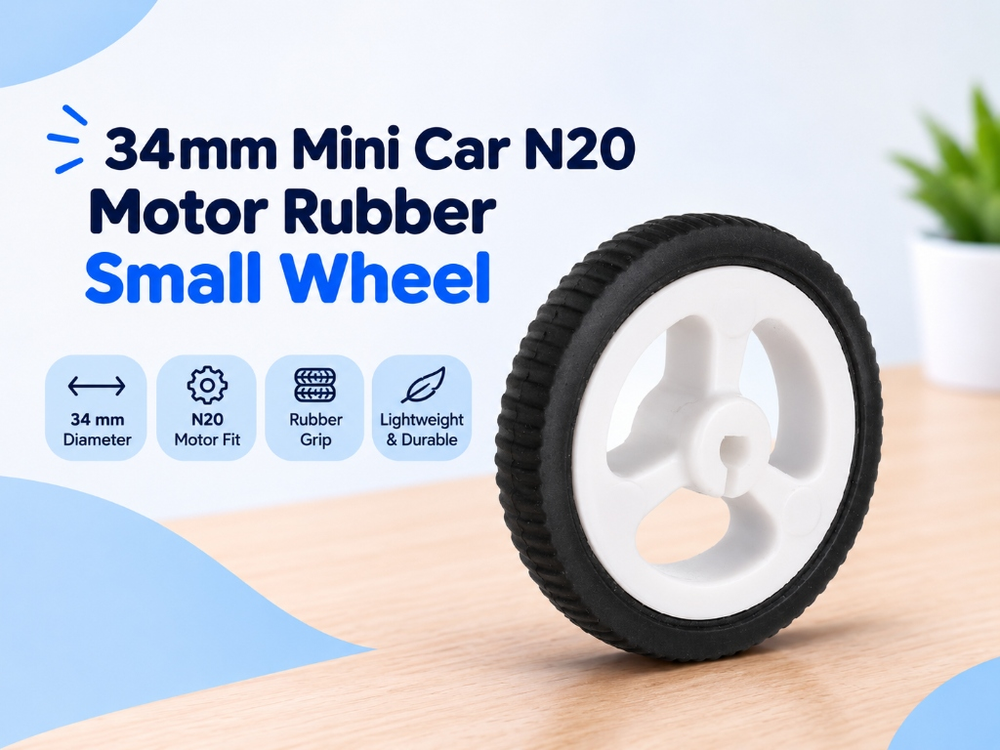

# 🤖 Autonomous Racer Robot (Fork Robot — 4WD Edition) — Guidance & Documentation

[](https://www.arduino.cc/)
[](https://isocpp.org/)
[](https://creativekhan123.github.io/Racerbot-Guidance/)
[](./Autonomous_Racer_Robot.html)
[]()
[]()
[]()
[]()
[]()

> **Teacher-friendly assembly, wiring, logic, and code guidance for building a 4WD autonomous obstacle-avoiding racer robot.**

---

## 📸 Project Showcase

<div align="center">
  
  <p><em>The assembled 4WD Autonomous Racer Robot ("Fork Robot") equipped with 3 forward-facing ultrasonic sensors in an angled bumper, L298N dual H-bridge motor driver, and 4 high-traction orange treaded wheels driven by M20 micro gear motors.</em></p>
</div>

---

## 📑 Table of Contents

- [Project Overview](#-project-overview)
- [Interactive Documentation Webpage](#-interactive-documentation-webpage)
- [Hardware Components](#-hardware-components)
- [Component Gallery](#-component-gallery)
- [Circuit & Wiring Guide](#-circuit--wiring-guide)
  - [Ultrasonic Sensors](#1-ultrasonic-sensor-connections)
  - [Motor Driver & Motors](#2-l298n-motor-driver-connections)
  - [Power Supply](#3-power-supply-connections)
- [How It Works (Autonomous Logic)](#-how-it-works-autonomous-logic)
- [Arduino Source Code](#-arduino-source-code)
- [Assembly & Setup (9 Steps)](#-assembly--setup-steps)
- [Pre-Flight Testing Checklist](#-pre-flight-testing-checklist)
- [Safety & Battery Guidelines](#-safety--battery-guidelines)
- [Author & License](#-author--license)

---

## 🎯 Project Overview

The **Autonomous Racer Robot** (nicknamed **"Fork Robot"** due to its three forward-pointing sensor prongs) is an intelligent, self-navigating 4WD mobile robot built using an **Arduino UNO** microcontroller board.

### Key Capabilities:
- **3-Way Real-Time Radar Perception**: Continuously scans distance on the **Left**, **Center**, and **Right** using three HC-SR04 ultrasonic sensors mounted at optimal forward detection angles.
- **Dynamic 4WD Obstacle Avoidance**: Automatically steers away from walls, obstacles, and dead ends without human intervention using high-traction 4-wheel differential steering.
- **4× M20 300 RPM Micro Gear Motors**: Heavy-duty metal reduction gearboxes provide all-wheel drive pulling power, stable low-noise running, and responsive cornering.
- **L298N Dual H-Bridge Motor Driver**: Proven high-current dual motor driver switching 8V battery power smoothly across the left and right motor pairs.
- **Beginner & Classroom Friendly**: Uses standard Arduino built-in functions with zero external dependencies, making it an ideal STEM robotics curriculum project.

---

## 🌐 Interactive Documentation Webpage

This repository includes a **complete, standalone interactive documentation webpage**:

📄 **[`Autonomous_Racer_Robot.html`](./Autonomous_Racer_Robot.html)**

### Webpage Highlights:
- **100% Self-Contained**: Works offline by double-clicking the file in any browser (Chrome, Edge, Safari, Firefox).
- **Dark Mode & Light Mode**: Built-in toggle button in the navbar and a floating action button (FAB).
- **Mobile & Android Responsive**: Specially optimized layout that renders cleanly on smartphones and tablets.
- **Interactive Component Gallery Grid**: Click any component card to reveal detailed specifications and teacher notes.
- **One-Click Code Copy & Download**: Download `Autonomous_Racer_Robot.ino` with a single click or copy directly into the Arduino IDE.
- **Interactive Testing Checklist**: Check off testing steps before deployment with automatic state persistence.
- **Print Friendly**: Specially formatted CSS for printing physical classroom handouts.

---

## 🛠 Hardware Components

| Component | Specification | Qty | Function in Robot |
| :--- | :--- | :---: | :--- |
| **Arduino UNO** | ATmega328P, 5V, 16 MHz | 1 | Central controller executing sensor logic and motor commands |
| **L298N Motor Driver Module** | Dual H-Bridge driver board (2A/ch) | 1 | High-current driver switching power to 4 DC motors |
| **M20 DC Gear Motors** | Micro metal gearbox, 300 RPM | 4 | All-metal geared motors providing 4WD drive torque |
| **Orange Treaded Wheels** | Direct-fit rubber treaded wheels | 4 | High-traction drive wheels attached to M20 motor shafts |
| **Ultrasonic Sensors** | HC-SR04 (40 kHz sound) | 3 | 3-way distance measurement (Left, Center, Right) |
| **Robot Chassis** | 4WD platform with angled bumper | 1 | Structural skeleton holding all 4 motors, driver, and sensors |
| **Battery Pack** | 8V rechargeable battery pack | 1 | Provides high-current power for motors and Arduino |
| **Jumper Wires** | DuPont Male-to-Female & M-M | ~20 | Signal and power interconnects between boards and sensors |
| **Rod & Bearing** | Smooth steel axle & miniature bearing set | 1 Set | Low-friction structural axle and bearing assembly |
| **Double-Sided Tape** | Heavy-duty mounting tape | 1 Roll | Secure mounting for battery and modules |

---

## 🖼 Component Gallery

<table align="center">
  <tr>
    <td align="center" width="50%">
      <br/>
      <strong>Arduino UNO</strong><br/>
      <em>Main Microcontroller &middot; Brain</em>
    </td>
    <td align="center" width="50%">
      <br/>
      <strong>L298N Motor Driver Module</strong><br/>
      <em>Dual H-Bridge High-Power Driver</em>
    </td>
  </tr>
  <tr>
    <td align="center" width="50%">
      <br/>
      <strong>M20 DC Gear Motors &times;4</strong><br/>
      <em>300 RPM Micro Metal Gear Motors (4WD)</em>
    </td>
    <td align="center" width="50%">
      <br/>
      <strong>High-Traction Wheels &times;4</strong><br/>
      <em>Anti-Slip Direct-Fit Treaded Wheels</em>
    </td>
  </tr>
  <tr>
    <td align="center" width="50%">
      <br/>
      <strong>HC-SR04 Ultrasonic Sensors &times;3</strong><br/>
      <em>Acoustic 3-Way Distance Sensors</em>
    </td>
    <td align="center" width="50%">
      <br/>
      <strong>8V Rechargeable Battery Pack</strong><br/>
      <em>Dedicated High-Discharge Power Source</em>
    </td>
  </tr>
</table>

---

## 🔌 Circuit & Wiring Guide

### 1. Ultrasonic Sensor Connections

All three HC-SR04 sensors share standard `5V` and `GND` power rails from the Arduino. Signal pins connect directly to digital I/O pins D2 through D7:

| Sensor Position | Sensor Pin | Arduino Pin | Pin Function |
| :--- | :--- | :--- | :--- |
| **Left Sensor** | `VCC` | `5V` | 5V Power |
| **Left Sensor** | `GND` | `GND` | Ground |
| **Left Sensor** | `TRIG` | `D2` | Trigger output pulse |
| **Left Sensor** | `ECHO` | `D3` | Echo input signal |
| **Center Sensor** | `VCC` | `5V` | 5V Power |
| **Center Sensor** | `GND` | `GND` | Ground |
| **Center Sensor** | `TRIG` | `D4` | Trigger output pulse |
| **Center Sensor** | `ECHO` | `D5` | Echo input signal |
| **Right Sensor** | `VCC` | `5V` | 5V Power |
| **Right Sensor** | `GND` | `GND` | Ground |
| **Right Sensor** | `TRIG` | `D6` | Trigger output pulse |
| **Right Sensor** | `ECHO` | `D7` | Echo input signal |

---

### 2. L298N Motor Driver Connections

The L298N driver receives logic signals from the Arduino and powers the 4 M20 motors (two left motors in parallel, two right motors in parallel):

| L298N Pin / Terminal | Connected To | Arduino Pin | Description |
| :--- | :--- | :--- | :--- |
| **IN1** | Left Motors PWM Speed | `D9` | Speed PWM signal for left motor pair |
| **IN2** | Left Motors Direction | `D8` | Direction control for left motor pair |
| **IN3** | Right Motors PWM Speed | `D11` | Speed PWM signal for right motor pair |
| **IN4** | Right Motors Direction | `D12` | Direction control for right motor pair |
| **ENA & ENB** | 5V Jumper Caps | Fitted | Keep jumpers fitted to enable both channels |
| **OUT1 & OUT2** | Left M20 Motors (&times;2) | Motor Terminals | 2 Left motors connected in parallel |
| **OUT3 & OUT4** | Right M20 Motors (&times;2) | Motor Terminals | 2 Right motors connected in parallel |

---

### 3. Power Supply Connections

| Terminal | Power Wire | Voltage | Notes |
| :--- | :--- | :--- | :--- |
| **L298N 12V / VMS (+)** | 8V Battery Red Wire (+) | `+8V` | Powers the 4 M20 motors. **Verify polarity!** |
| **L298N GND (-)** | 8V Battery Black Wire (-) | `0V (GND)` | Ground reference from battery |
| **L298N GND (-)** | Arduino GND Pin | `GND` | **Crucial!** Common ground reference |
| **L298N 5V Out** | Arduino 5V / VIN Pin | `5V` | Optional regulated 5V to power Arduino |

> ⚠️ **IMPORTANT POWER SAFETY**:
> - Always verify battery polarity (`+` to `+`, `-` to `-`). Reversing polarity can permanently damage the L298N driver and Arduino.
> - Never connect the 8V battery directly to Arduino 5V or I/O pins.
> - Always connect L298N GND and Arduino GND together to establish a shared ground reference.

---

## 🧠 How It Works (Autonomous Logic)

The robot operates using a continuous sense-think-act control loop:

```
[Start Loop]
     │
     ▼
[Read 3 Ultrasonic Sensors] (Left, Center, Right in cm)
     │
     ├───────────────────────────────────────────────────────┐
     │                                                       │
     ▼                                                       ▼
[Center < 15 cm?]                                      [Center Clear (>= 15 cm)]
     │ YES                                                   │
     ▼                                                       ├─ Left < 12 cm?  ──► Turn RIGHT (+200, -200)
[Reverse & Turn]                                             ├─ Right < 12 cm? ──► Turn LEFT  (-200, +200)
(Back up 220ms, then pivot left 220ms)                       └─ Both Clear?    ──► Cruise FORWARD (130, 130)
```

### Decision Matrix:

| Sensor Condition | Distance Thresholds | Robot Action | Left Motors | Right Motors |
| :--- | :--- | :--- | :---: | :---: |
| **Path Ahead Clear** | Center &ge; 15cm, Left & Right &ge; 12cm | Cruise forward smoothly | `FORWARD (PWM 130)` | `FORWARD (PWM 130)` |
| **Obstacle on Left** | Left &lt; 12cm, Right &ge; 12cm | Steer right in place | `FORWARD (PWM 200)` | `REVERSE (PWM 200)` |
| **Obstacle on Right** | Right &lt; 12cm, Left &ge; 12cm | Steer left in place | `REVERSE (PWM 200)` | `FORWARD (PWM 200)` |
| **Front Obstacle / Corner** | Center &lt; 15cm | Reverse 220ms, then pivot left | `REVERSE (PWM 200)` | `REVERSE (PWM 200)` |

---

## 💻 Arduino Source Code

The full, tested Arduino sketch is located at:

📁 **[`arduino_code/arduino_code.ino`](./arduino_code/arduino_code.ino)** (also available as **[`autoracerl298n.ino`](./autoracerl298n.ino)**)

```cpp
// Motor Driver Pins (PWM pins on Uno: 3,5,6,9,10,11)
const int IN1 = 9;   // Left motor speed
const int IN2 = 8;   // Left motor direction
const int IN3 = 11;  // Right motor speed
const int IN4 = 12;  // Right motor direction (D12)

// Ultrasonic Sensor Pins
const int trig1 = 2;  const int echo1 = 3;   // Left sensor
const int trig2 = 4;  const int echo2 = 5;   // Center sensor
const int trig3 = 6;  const int echo3 = 7;   // Right sensor

const float MAX_SENSOR_DISTANCE       = 200.0;  // cm
const float FRONT_OBSTACLE_THRESHOLD  = 15.0;   // cm - center sensor triggers backup + turn
const float SIDE_OBSTACLE_THRESHOLD   = 12.0;   // cm - left/right sensors trigger turn
const unsigned long SENSOR_INTERVAL   = 50;     // ms between sensor reads
const unsigned long BACKUP_DURATION   = 220;    // ms to reverse when front obstacle detected

unsigned long lastSensorReadTime = 0;

void motor1(int speed) {       // Left Motor speed
  if (speed > 0) {
    digitalWrite(IN1, LOW);
    analogWrite(IN2, speed);       // Forward
  } else if (speed < 0) {
    digitalWrite(IN1, HIGH);
    analogWrite(IN2, speed);      // Backward 
  } else {
    digitalWrite(IN1, HIGH);
    analogWrite(IN2, HIGH);       // Stop
  }
}

void motor2(int speed) {      // Right Motor speed 
  if (speed > 0) {
    digitalWrite(IN3, LOW);
    analogWrite(IN4, speed);       // Forward
  } else if (speed < 0) {
    digitalWrite(IN3, HIGH);
    analogWrite(IN4, speed);      // Backward
  } else {
    digitalWrite(IN3, HIGH);
    analogWrite(IN4, HIGH);       // Stop
  }
}

void motorControl(int leftSpeed, int rightSpeed) {
  motor1(leftSpeed);
  motor2(rightSpeed);
}

void setup() {
  Serial.begin(9600);

  // Ultrasonic pins
  pinMode(trig1, OUTPUT); pinMode(echo1, INPUT);
  pinMode(trig2, OUTPUT); pinMode(echo2, INPUT);
  pinMode(trig3, OUTPUT); pinMode(echo3, INPUT);

  // Motor pins
  pinMode(IN1, OUTPUT); pinMode(IN2, OUTPUT);
  pinMode(IN3, OUTPUT); pinMode(IN4, OUTPUT);

  motorControl(0, 0); // Start stopped
  Serial.println("Robot Ready!");
}

void loop() {
  unsigned long currentMillis = millis();

  if (currentMillis - lastSensorReadTime >= SENSOR_INTERVAL) {
    lastSensorReadTime = currentMillis;

    float leftDist   = getDistance(trig1, echo1);
    float centerDist = getDistance(trig2, echo2);
    float rightDist  = getDistance(trig3, echo3);

    Serial.print(leftDist);
    Serial.print("       ");
    Serial.print(centerDist);
    Serial.print("       ");
    Serial.println(rightDist);

    if (centerDist < FRONT_OBSTACLE_THRESHOLD) {
      motorControl(-200, -200);
      delay(BACKUP_DURATION);
      motorControl(-200, 200);  // Turn Left in place
      delay(BACKUP_DURATION);
    }
    else if (leftDist < SIDE_OBSTACLE_THRESHOLD) {
      motorControl(200, -200);  // Turn Right in place
    }
    else if (rightDist < SIDE_OBSTACLE_THRESHOLD) {
      motorControl(-200, 200);  // Turn Left in place
    }
    else {
      motorControl(130, 130);   // Go Forward
    }
  }
}

float getDistance(int trigPin, int echoPin) {
  digitalWrite(trigPin, LOW);
  delayMicroseconds(2);
  digitalWrite(trigPin, HIGH);
  delayMicroseconds(10);
  digitalWrite(trigPin, LOW);
                                                                                                                                          
  long timeout = (MAX_SENSOR_DISTANCE * 2.0 / 0.0343) + 3000;
  long duration = pulseIn(echoPin, HIGH, timeout);

  if (duration == 0) return MAX_SENSOR_DISTANCE;

  float distance = duration * 0.0343 / 2.0;

  if (distance > MAX_SENSOR_DISTANCE) return MAX_SENSOR_DISTANCE;
  if (distance < 0) return 0.0;

  return distance;
}
```

---

## 🔨 Assembly & Setup Steps

1. **Prepare 4WD Chassis**: Unpack the 4WD chassis base and identify mounting slots for the four M20 motors, L298N driver, Arduino, battery, and 3-sensor bumper.
2. **Mount 4× M20 Motors & Wheels**: Secure the four 300 RPM M20 micro gear motors into side mounting brackets (2 left, 2 right). Press orange treaded wheels firmly onto each motor shaft.
3. **Mount Arduino & L298N Module**: Fasten the Arduino UNO and the L298N motor driver module onto the chassis using screws or heavy-duty tape.
4. **Mount 3 Ultrasonic Sensors**: Insert the three HC-SR04 sensors into the angled front bumper housing facing Left, Center, and Right.
5. **Connect Sensor Wiring**: Connect VCC&rarr;5V, GND&rarr;GND, Left TRIG/ECHO&rarr;D2/D3, Center TRIG/ECHO&rarr;D4/D5, and Right TRIG/ECHO&rarr;D6/D7.
6. **Connect Motor Terminals**: Wire the two left M20 motors in parallel to OUT1 & OUT2, and the two right M20 motors in parallel to OUT3 & OUT4. Connect IN1&rarr;D9, IN2&rarr;D8, IN3&rarr;D11, IN4&rarr;D12.
7. **Connect 8V Power Supply**: Connect the 8V battery (+) to the L298N 12V terminal, battery (-) to GND, and link L298N GND to Arduino GND (common ground). **Check polarity!**
8. **Upload Arduino Program**: Connect Arduino to computer via USB, open `autoracerl298n.ino` in Arduino IDE, select **Arduino UNO**, and click **Upload**.
9. **Field Test**: Place the 4WD robot on a clear floor, power on the 8V battery, and watch it cruise and steer smoothly around obstacles!

---

## ✅ Pre-Flight Testing Checklist

- [ ] Arduino UNO powers on (green LED lit)
- [ ] L298N motor driver power LED lit steadily
- [ ] Common ground connected between L298N GND and Arduino GND
- [ ] 8V Battery polarity verified (`+` Red, `-` Black)
- [ ] Both left M20 motors rotate forward when commanded
- [ ] Both right M20 motors rotate forward when commanded
- [ ] All 4 orange wheels spin freely without chassis contact
- [ ] Left ultrasonic sensor displays accurate distance on Serial Monitor (D2/D3)
- [ ] Center ultrasonic sensor displays accurate distance on Serial Monitor (D4/D5)
- [ ] Right ultrasonic sensor displays accurate distance on Serial Monitor (D6/D7)
- [ ] Robot cruises forward smoothly (PWM 130) when path is clear
- [ ] Robot turns right in place when obstacle placed &lt; 12 cm near left sensor
- [ ] Robot turns left in place when obstacle placed &lt; 12 cm near right sensor
- [ ] Robot reverses (220 ms) and pivots when obstacle &lt; 15 cm directly in front

---

## ⚠️ Safety & Battery Guidelines

- **Polarity Warning**: Never reverse battery polarity. Reversing `+` and `-` will burn the L298N driver IC immediately.
- **Common Ground Requirement**: Always ensure L298N GND and Arduino GND are connected together so logic signals have a reference point.
- **Voltage Separation**: Never feed 8V directly into Arduino 5V or I/O pins (pins operate at 5V logic only).
- **Mechanical Safety**: Keep fingers, hair, and loose wires away from the 4 spinning wheels and motor gears while powered.
- **Safe Testing Area**: Test the robot on an open, flat floor away from staircases and table edges.

---

## 👤 Author & License

- **Author**: Mohd Zeeshan ([@Creativekhan123](https://github.com/Creativekhan123))
- **Project**: Autonomous Racer Robot ("Fork Robot" — 4WD Edition)
- **License**: [MIT License](LICENSE) &mdash; Free for educational, student, and personal use.
